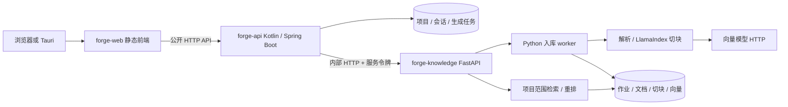

# 服务结构和数据归属

三个工程拥有各自的依赖清单、构建入口、配置、数据目录和容器上下文。同一个 Git 仓库便于协同变更，服务间只通过 HTTP 和版本化契约交互。

- 前端只消费公开 API，前端构建不生成后端资源，API jar 不包含前端。
- Kotlin 拥有业务项目和生成命令队列，校验项目访问、组合公开接口与上下文。文档处理的技术细节不会进入 Kotlin 调度器。
- Python 拥有文档作业、文件内容、索引、失败和重试状态；Kotlin 重启无需恢复 Python 作业。Python 自身重启采用失败后显式重试策略。
- 业务库与知识库物理分开，禁止共同写同一目录或表。当前本地默认各自 SQLite；持久化端口允许独立替换数据库。
- 对外入口为前端代理或网关；Python 仅内部可达，服务令牌不进入前端环境变量。

本地 `scripts/workspace.py` 和容器 Compose 是可选编排层。删除它们后，每个工程仍能按自身 README 构建运行。契约同步是显式维护动作，不是应用构建步骤。

`architecture/` 中原有 HTML 图保留为早期迁移规划快照，当前实际目录、数据归属和启动方式以本文件为准。
